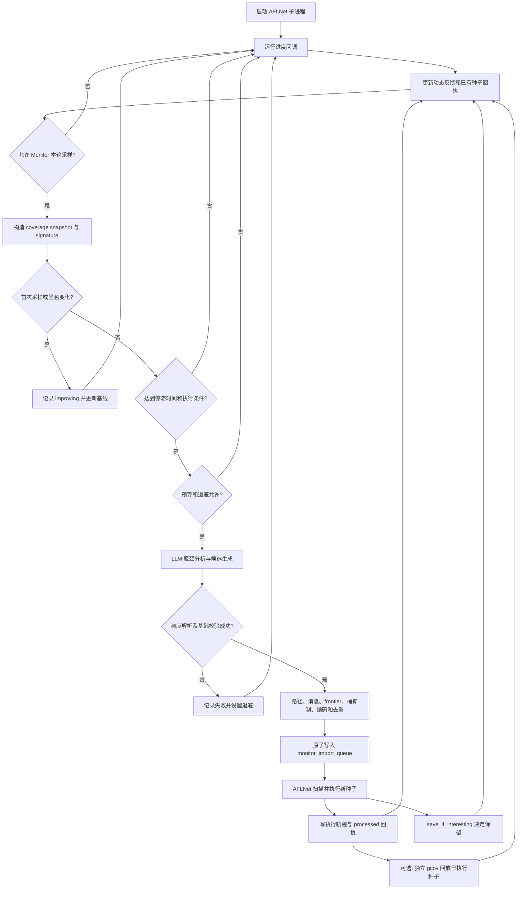

# MonitorAgent 功能与执行流程

本文依据当前仓库实现说明 `monitor_agent` 的实际行为，覆盖从 AFLNet 运行采样、停滞判断、LLM 候选生成，到导入执行和结果回流的全过程。

代码入口是 [protolens/agents/monitor_agent.py](protolens/agents/monitor_agent.py)。整体架构见 [design.md](design.md)；[monitor_agent_analysis.md](monitor_agent_analysis.md) 是一次实验的效率分析，包含当时的问题与改进建议，不能将其中所有描述视为当前实现。

## 1. 功能定位与职责边界

MonitorAgent 的作用是：在 AFLNet 运行过程中识别探索停滞，利用实际执行反馈和已有路径信息，请求 LLM 生成新的协议输入，再交给 AFLNet 判断这些输入是否值得保留。

它主要完成六项工作：

1. 采集反馈快照，比较覆盖率及协议状态统计是否变化。
2. 在满足时间、执行次数和调用预算条件后，组织瓶颈分析上下文。
3. 请求 LLM 返回可由客户端发送的协议消息序列。
4. 校验候选的路径身份、消息、frontier 范围和重复情况，编码并发布种子。
5. 持久化种子身份、模型调用预算、执行回执和历史尝试。
6. 将成功、失败、未执行和覆盖率回放结果提供给后续分析。

各组件的分工如下：

| 组件 | 负责的工作 |
| --- | --- |
| `MonitorAgent` | 停滞决策、LLM 上下文、候选筛选、种子发布、回执整理 |
| `AFLNetDynamicAnalyzer` | 读取 AFLNet 输出，提取统计、IPSM、queue 与 execution frontier |
| `SeedFeedbackAnalyzer` | 归因初始语料及其 intent/variant 的观察结果 |
| `CorpusEncoder` | 把候选消息转换为目标协议的字节流 |
| 修改后的 `afl-fuzz.c` | 导入、实际执行、记录路径、调用 `save_if_interesting()` |
| `SourceCoverageCollector` | 在独立 gcov 目标上回放，采集逐用例及累计源码覆盖率 |
| `ProtoLensPipeline` | 串联采样回调、Monitor、产物更新和异常隔离 |

MonitorAgent 不自行修改目标源码、重建 FSM、重新启动 fuzzing，也不直接控制网络连接来完成 TLS 升级或数据通道协商。运行结束后的 crash replay、closed-loop replanning 和 transport harness 由 pipeline 的其他组件负责。

**候选生成不等于执行成功，执行成功不等于被 AFLNet 保留，被保留也不等于某条语义路径已经得到严格证明。**

## 2. 全链路流程图



图中的循环由运行进度回调驱动。MonitorAgent 本身不是一个独立后台线程；gcov 收集器有单独的后台执行流程。

## 3. 启动条件与调度方式

### 3.1 启动前准备

`AFLNetAdapter.prepare()` 在 Monitor 启用时创建导入目录及 `.processed/`。默认位置为：

```text
<run_dir>/monitor_import_queue/
```

可以通过 `monitor_agent.import_dir` 指定其他位置。启动 AFLNet 时，adapter 将这个路径放入子进程环境变量：

```text
AFLNET_PROTOLENS_IMPORT_DIR=<实际导入目录>
```

必须使用包含 `import_protolens_monitor_seeds()` 的 AFLNet 二进制。仅配置这个环境变量，不会让一个未经修改的 AFLNet 自动具备导入能力。

### 3.2 两层采样节奏

`AFLNetAdapter.execute()` 启动子进程后发送一次进度回调，之后循环检查进程并再次回调。通常每轮睡眠 5 秒；设置运行时限时，临近截止时间可能缩短。

`MonitorAgent.observe()` 内部另外使用 `interval_seconds` 节流，默认 30 秒。所以：

- pipeline 的反馈与产物更新可以比 Monitor 的停滞决策更频繁。
- 每次进度回调不等于一次 Monitor 决策，更不等于一次 LLM 请求。
- `force=True` 仅跳过采样间隔检查，不跳过启用状态、运行模式、停滞和预算条件。正常 pipeline 回调不传此参数。

LLM 请求在进度回调中同步执行。请求期间 AFLNet 子进程继续运行，但下一次 Python 进度回调以及 adapter 的超时检查可能被延后；不能把 5 秒或 30 秒理解为严格定时保证。

### 3.3 可处理的运行模式

`observe()` 接受 `running`、`timed-out`、`executed` 模式，但正常 pipeline 主要在运行中的回调调用它。以下情况不启动瓶颈分析：

| 条件 | 返回结果 |
| --- | --- |
| `monitor_agent.enabled=false` | `disabled` |
| `aflnet.dry_run=true` 或不支持的运行模式 | `inactive` |
| 距上次有效采样不足 `interval_seconds` | 返回 `None`，不新增本轮 decision |
| 尚无 AFLNet 统计 | `waiting_for_stats` |

任务结束时，pipeline 更新最终动态产物和执行回执；不会自动额外发起一轮最终 LLM 分析。

## 4. 输入数据从哪里来

每次 `_handle_fuzz_progress()` 先调用 `_write_campaign_artifacts()`：

1. `dynamic_analyzer.analyze()` 从 AFLNet 输出提取动态信息。
2. 加入独立 gcov 收集器的 `source_coverage` 反馈。
3. 调用 `monitor_agent.refresh_feedback()`，刷新历史 Monitor 种子的执行回执。
4. 计算 `state_mapping`，读取初始 `seed_manifest.json` 并生成 `seed_feedback`。
5. 写出 `dynamic_analysis.json`、`seed_feedback.json` 等产物。
6. 将动态结果、`planned_paths`、`conflicts` 和初始 seed feedback 交给 `observe()`。

| 输入 | 内容及用途 |
| --- | --- |
| `FuzzResult` | 当前运行模式、输出目录、crash/hang 文件等运行信息 |
| `dynamic.fuzzer_stats` / `latest_plot` | 执行次数、速度、路径数、bitmap 覆盖等统计 |
| `dynamic.ipsm` | 协议响应状态图的节点及边统计 |
| `dynamic.execution_fsm.frontier` | 从实际 queue 反馈整理的命令序列、queue 身份与可参考前缀 |
| `planned_paths` | 候选路径身份、关联 conflict、状态、消息、guard、变异点、校准信息 |
| `conflicts` | 冲突类型、优先级、描述、期望路径及 fuzzing 策略 |
| `seed_feedback` | 初始语料的 observed/unobserved、variant 和 conflict 汇总 |
| `monitor_seed_manifest.json` | 历史 Monitor 种子及其实际执行结果 |
| `dynamic.source_coverage` | 独立 gcov 的累计覆盖、未覆盖区域、源码片段与最近用例结果 |

“初始语料反馈”和“Monitor 种子反馈”是两个入口；不能只查看 `seed_feedback.json` 就判断 Monitor 是否获得了自己的执行结果。

## 5. 如何判定覆盖停滞

### 5.1 快照与签名

`_coverage_snapshot()` 整理统计；`_coverage_signature()` 只取以下十个字段形成 tuple：

```text
paths_total
last_path
bitmap_cvg
ipsm_nodes
ipsm_edges
queue_count
crash_count
hang_count
source_covered_lines
source_covered_branches
```

其中后两项是 gcov 汇总中的已覆盖行数和已覆盖分支数；未启用或没有结果时通常为 0。

执行数 `execs_done`、执行速度 `execs_per_sec` 和 `health_signals` 在快照中，但不直接进入签名。签名经 JSON 序列化和 SHA-256 截断生成 `sig_...`，作为持久化预算的索引。

首次建立基线，或者签名与上次基线不同，就返回 `improving`，并保存：

```text
signature   = 当前签名
execs_done  = 当前累计执行数
observed_at = 当前 monotonic 时间
```

这里判断的是**签名是否变化**，不是逐项检查数值是否增长。crash/hang 数量变化、queue 数量变化或统计重置都可能触发 `improving`，不能直接将该状态解读为新增源码覆盖。

### 5.2 时间条件与执行数条件

签名没有变化时计算：

```text
stagnant_for = 当前时间 - 基线时间
exec_delta  = max(0, 当前 execs_done - 基线 execs_done)
```

检查顺序如下：

1. `stagnant_for < stagnation_seconds`：返回 `not_stagnant`。
2. `exec_delta < min_exec_delta` 且 `execs_per_sec > 0`：返回 `warming_up`。
3. 否则进入 LLM 预算和退避判断。

默认需要稳定约 300 秒，并在有正执行速度时累计至少 1000 次执行。若速度为 0、缺失或无法转为正数，第二项条件不会阻止进入分析；因此 Monitor 也可能对执行停止的 campaign 进行瓶颈诊断。

写出至少一个种子后，代码会把上述基线时间和执行数重置为本轮采样值，即使签名没变。这是当前的再次观察等待机制，**不是确认种子已产生新覆盖**。

## 6. LLM 调用预算、失败与退避

每个 coverage signature 分别维护：

| manifest 字段 | 含义 |
| --- | --- |
| `coverage_llm_calls` | 成功解析并通过分析响应基础校验的调用次数 |
| `coverage_llm_failures` | 该签名下连续记录的分析失败次数 |
| `coverage_llm_retry_after` | 允许重试的 monotonic 时间阈值 |

满足停滞后按以下顺序检查：

1. 成功次数达到 `max_llm_calls_per_stagnation_signature`：`stagnant_llm_suppressed`。
2. 当前时间早于 retry-after：`stagnant_llm_backoff`。
3. 失败次数达到 `max_llm_failures_per_stagnation_signature`：`stagnant_llm_failure_suppressed`。
4. 否则发起分析。

失败后的等待时间为：

```text
llm_failure_backoff_seconds × 2^(失败次数 - 1)
```

默认依次为 120、240、480 秒。退避判断先于失败上限判断，因此达到第三次失败后，仍可能先看到 `stagnant_llm_backoff`，等退避窗口结束才显示失败预算抑制。

成功响应会增加成功调用次数，清除失败计数与 retry-after，然后才进入种子筛选。于是：

- 空候选数组、全部候选重复、全部候选未通过路径筛选，仍可能消耗一次成功预算。
- 默认同一签名只允许一次成功分析；没有新签名时，写出种子也不会恢复预算。
- 离线模型、网络异常、JSON 解析错误和分析响应基础校验失败返回 `llm_failed`，不消耗成功预算。
- LLM 客户端本身的重试与此处的“停滞签名重试”是两层机制。

这些计数写入 manifest，Monitor 重建后可以恢复；但基线时间和 `_last_check_at` 不持久化，需要重新建立观察窗口。retry-after 存的是 monotonic 数值，不能把它当作 UTC 时间，也不能保证机器重启后具有相同的时间基准。

## 7. LLM 接收什么、返回什么

### 7.1 请求上下文

`_analyze_bottleneck_with_llm()` 通过共享的 `LLMClient.chat_json()` 请求 JSON 响应，使用配置中的 LLM provider/model。没有单独的 Monitor 模型配置项。

请求包含：

| 字段 | 作用 |
| --- | --- |
| `task`、`seed_message_contract` | 限定当前协议及客户端消息格式 |
| `dynamic_feedback` | 压缩后的 AFLNet 统计、IPSM、queue、健康信息 |
| `execution_frontier` | 引导模型围绕已有执行序列做局部变异 |
| `planned_paths`、`conflicts` | 将候选与可审计的路径、guard、冲突关联 |
| `seed_feedback` | 初始语料中已观察与未观察的尝试 |
| `monitor_seed_feedback` | 历史 Monitor 种子的保留、未保留、待执行样例及回执 |
| `frontier_feedback` | 哪些前缀组已反复处理却没有得到保留 |
| `previous_monitor_seeds` | 历史消息、哈希、期望覆盖及执行结果，帮助避免重复 |
| `source_coverage`、`uncovered_regions` | 未覆盖的文件、行、分支、函数和源码片段 |
| `heuristic_seed_templates` | 根据 path/guard 构造的提示模板，仅供 LLM 参考 |
| `required_output` | 要求返回的候选结构和解释字段 |

部分上下文会截断，例如最多 120 条 planned paths、120 条 conflicts、40 条 frontier candidates、80 个 heuristic templates、最近 40 条 previous monitor seeds。实际执行路径的 prompt 摘要最多保留 128 个状态和 32 条消息，完整记录留在工件中。

模板不是离线兜底生成器。模型不可用时，代码不会直接把模板当作“LLM 突破种子”发布。

### 7.2 响应示例

以下示例只说明结构，ID 必须取自实际请求上下文：

```json
{
  "bottleneck_summary": "已观察到认证前缀，但某个参数错误分支尚未覆盖。",
  "seed_candidates": [
    {
      "conflict_id": "conflict_example",
      "candidate_id": "candidate_example",
      "frontier_queue_id": "queue_example",
      "target_uncovered_region_id": "cov_example",
      "messages": ["USER anonymous", "PASS test", "CWD /missing-directory"],
      "rationale": "保留已观察前缀，修改路径参数以尝试错误处理。",
      "expected_new_coverage": "尝试到达 source.c 的目标检查分支；是否覆盖需由执行结果验证。"
    }
  ]
}
```

Schema 规定最多 16 个候选，每个候选 1～32 条消息。必填字段包括 `conflict_id`、`messages`、`rationale` 和 `expected_new_coverage`。`candidate_id`、`frontier_queue_id`、`target_uncovered_region_id` 在 Schema 中可选，但存在未覆盖区域时，本地校验要求 `target_uncovered_region_id` 引用可用区域。

未覆盖区域 ID 根据文件名、未覆盖行/分支和函数信息生成，形如 `cov_<hash>`，不是源文件永久不变的编号。覆盖状态变化后，ID 可能变化。

Prompt 要求不同候选选择不同未覆盖区域；当前本地校验检查的是 ID 是否有效，**没有强制校验候选之间的区域唯一性**。`expected_new_coverage` 是模型预测说明，不是测量结果。

## 8. 候选如何被筛选和编码

响应基础校验会拒绝缺失必要字段、无效区域引用、明显的 TCP reset、half-close、关闭 socket、TLS renegotiation 等传输动作。此阶段一个候选出错可能使整次分析返回 `llm_failed`。

通过基础校验后，`_write_llm_breakthrough_seeds()` 按返回顺序处理候选；个别候选被跳过时，原因进入 `skipped_candidates`。

### 8.1 选择关联路径

优先用 `candidate_id` 查找可达路径。没有该字段时，使用 `conflict_id` 对应的可达路径列表，只有唯一可达路径时才接受。

不存在、不可达或存在歧义时跳过，原因为：

```text
unknown, ambiguous, or unreachable candidate path
```

当前实现把 `candidate_id` 当作优先选择键，没有额外强制检查它与响应中的 `conflict_id` 是否一致。因此模型必须保持二者一致，不应把该步骤描述为完整的身份一致性证明。

### 8.2 筛出客户端消息

`client_seed_message()` 根据协议过滤非客户端可发送内容；过滤后为空则跳过。候选应是网络消息，而不是 `accept()`、线程创建等服务端内部事件。

FTP 等高层消息可能被编码器规范化或补默认参数。如果测试意图依赖缺参、异常空白或精确字节，应使用编码器支持的 `raw:`、`raw-b64:` 等形式。

raw 表示字节内容，不表示能够控制每次 TCP write 的时机、报文分片或多个连接。Monitor 最终写出的是协议请求流；发送边界仍由 AFLNet 的协议提取器和网络发送逻辑决定。

### 8.3 execution frontier 检查

`_frontier_match()` 从实际反馈取得命令序列和已观察前缀，比较候选的命令类型前缀：

```text
required = min(2, 已观察序列长度, 候选命令序列长度)
```

候选前 `required` 个命令与任一参考序列相同，即可通过此检查。不存在可用 frontier 时，该检查返回 `None`，不会仅因缺少 frontier 而拒绝候选。

这是一种有限的前缀约束：不验证完整请求参数、认证是否成功、目标 guard 是否满足，也不重新执行 preflight。对于文本协议的 raw 消息，方法提取通常得到 `RAW`，可能无法匹配 `USER/PASS` 等普通命令前缀。

不匹配时记录 `outside_verified_execution_frontier`。

### 8.4 抑制反复无效的前缀组

frontier bucket 的键优先来自模型提供的 `frontier_queue_id`，其次来自匹配的 frontier 命令，最后来自候选消息的命令前缀；命令键通常取前六项。

满足以下条件时，该组被抑制：

```text
该组 saved_interesting_count == 0
且 failed_without_new_coverage >= frontier_failure_threshold
```

默认阈值为 3。当前“失败”计数按 `processed=true` 且没有 `saved_interesting` 累积，可能包含未实际执行或异常结束的条目，不只是成功执行后的零覆盖用例。只要该组历史上存在被保留条目，上述抑制条件就不成立。

该机制是历史尝试统计，不是严格验证过的状态空间划分。模型提供的 queue ID 也没有在此步骤独立验证归属。

### 8.5 编码与双层去重

通过筛选后，以候选消息构造 `PlannedStatePath`，调用 `CorpusEncoder.payload_for_path()` 获得原始协议字节流。编码结果为空则跳过。

去重同时使用：

1. canonical key：路径候选身份加规范化后的消息序列。
2. payload SHA-256：最终编码字节流的哈希。

任一命中历史集合都记录 `duplicate_monitor_seed`。普通消息的 canonical 规范化会折叠空白并统一命令大小写；raw 消息保留原文本。字节层去重还能识别不同描述经编码后生成同一 payload 的情况。

这两个集合主要来源于历史 Monitor manifest 与导入目录扫描，**不是对整个初始 corpus 和 AFLNet queue 的全量去重**。

## 9. 种子发布与 AFLNet 实际导入

### 9.1 原子发布

发布文件名形如：

```text
id:000001,src:protolens_monitor,<canonical_key前缀>
```

写入顺序为：

```text
写隐藏 .tmp 文件
→ replace 为正式种子文件
→ 加入哈希及 canonical 集合
→ 保存种子记录
→ 原子更新 monitor_seed_manifest.json
```

AFLNet 扫描跳过点开头的文件，从而避免读取尚未写完的 payload。默认每轮最多实际写出 8 个种子；达到上限后结束当前批次，剩余候选不会自动排入待写列表。

新种子的初始回执是：

```json
{"processed": false, "outcome": "pending_import"}
```

写出至少一个种子，decision 为 `stagnant`；没有写出种子则为 `stagnant_no_seed`。

### 9.2 C 侧导入流程

`afl-fuzz.c::import_protolens_monitor_seeds()` 在主循环的多个位置被调用，扫描节流约为 1 秒。这不是额外后台线程，实际消费时间还受 AFLNet 当前操作影响。

对每个没有同名 `.processed` 标记的文件，导入器执行：

1. 检查是否为非空普通文件，且大小不超过 `MAX_FILE`。
2. 将 payload 写到测试输入，通过协议提取器拆分请求 regions。
3. 构造 `kl_messages`，调用 `run_target()`。
4. 判断本次是否增加 `total_execs`，记录执行状态及 fault。
5. 在 `save_if_interesting()` 的可能校准重放之前保存首次导入执行的轨迹。
6. 在确实执行且未停止时调用 `save_if_interesting()`。
7. 记录 queue 前后数量、请求数和轨迹状态，原子写入 `.processed/<seed_name>`。

新增 queue entry 会被设置较高的 `handicap`、标记 favored，并影响后续优先 fuzz 的位置。

`paths_imported` / `queued_imported` 与 `save_if_interesting()` 的返回值有关，不是 Monitor 发布文件数。crash/hang 的保存与普通 queue 增长也应分开检查，不能只看候选数就计算有效覆盖收益。

## 10. 执行回执与结果回流

### 10.1 回执字段

`.processed/<seed_name>` 中的主要字段如下：

| 字段 | 含义 |
| --- | --- |
| `processed` | 导入器已经处理该文件 |
| `executed` | 首次导入过程中实际执行计数是否增加 |
| `fault` | AFLNet 的执行结果代码，需按 AFLNet 定义解释 |
| `saved_interesting` | `save_if_interesting()` 的保留结果 |
| `queued_before` / `queued_after` | 本次保留处理前后的 queue 数量 |
| `region_count` / `messages_sent` | 解析到的请求 region 数量及发送统计 |
| `execution_trace_written` | 是否成功写出首次执行轨迹 |
| `seed_file` | 对应的种子文件名 |

`processed=true` 不代表 `executed=true`。例如文件为空或大小超限，可能产生已处理但未执行的回执。

`_receipt_outcome()` 依优先级整理出：

| outcome | 判断方式 |
| --- | --- |
| `saved_interesting` | 回执或 queue 匹配表明已保留 |
| `pending_import` | 尚未 processed |
| `processed_not_executed` | processed 且 executed 明确为 false |
| `executed_fault_<code>_no_new_coverage` | 未保留，且 fault 非零 |
| `executed_no_new_coverage` | 其他已处理、未保留情况 |

旧的空标记或非 JSON 标记仍可读，但无法提供完整执行证据；相关路径标记为 `unavailable`，不能根据兼容分支生成的 outcome 反推精确执行过程。

### 10.2 首次执行轨迹

```text
monitor_import_queue/.traces/<seed_name>
```

轨迹包括响应状态 ID 序列、对应响应码、各条请求的字节范围与累计状态、AFL 分类后的 bitmap 槽位等信息。保存时机早于后续校准，且没有被 queue 保留的种子也可以有轨迹。

bitmap 是哈希反馈槽位及计数桶，不是无碰撞的源码分支列表，更不是有序的源码执行轨迹。响应状态也不能自动等同于源代码或规范 FSM 中的语义状态。

manifest 中的 `execution_receipt.execution_path` 保存摘要和工件路径；bitmap 的完整 `entries` 留在 `.traces` 文件中，避免全部塞入下一轮 LLM prompt。

### 10.3 独立源码覆盖率

开启 `source_coverage` 后，收集器扫描两类输入：

- AFLNet 的 `queue/`。
- Monitor 导入目录中已有 `executed=true` JSON 回执的种子，即使该种子未被 AFLNet 保留。

每个 Monitor 用例的索引结果写入：

```text
source_coverage/monitor/<seed_name>.json
```

逐文件行、分支和函数计数位于对应 HTML snapshot 的 `case_coverage.json`；`coverage.json` 表示累计结果。

Monitor 将该记录中的 payload SHA-256 与 manifest 比对，避免将旧回放错配给已经改变的输入。结果未就绪时记录 `pending_replay`，尚未执行则为 `pending_import`，未启用则为 `disabled`。

这是另一个 gcov 进程中的回放结果，与 AFLNet 首次执行具有不同来源。不能把 gcov 新覆盖当作 AFLNet 二进制获得相同覆盖的证明。

### 10.4 何时刷新

pipeline 在运行回调和最终产物更新时都会调用 `refresh_feedback()`。因此即使统计正在变化、未达到停滞窗口或 LLM 预算已用完，回执仍会刷新。

下次模型分析会看到最近被保留、处理后未保留以及待导入的样例，并带上执行路径和独立源码覆盖摘要。模型预测由此获得可用于后续判断的执行证据。

## 11. 状态速查

| status | 主要含义 | 本轮是否请求 LLM |
| --- | --- | --- |
| `disabled` | 配置关闭 | 否 |
| `inactive` | dry-run 或运行模式不适用 | 否 |
| `waiting_for_stats` | 统计尚未出现 | 否 |
| `improving` | 建立基线或统计签名变化 | 否 |
| `not_stagnant` | 未达到停滞时间 | 否 |
| `warming_up` | 有正速度，但执行增量不足 | 否 |
| `stagnant_llm_suppressed` | 当前签名成功调用预算已用完 | 否 |
| `stagnant_llm_backoff` | 当前签名仍在失败退避期 | 否 |
| `stagnant_llm_failure_suppressed` | 当前签名失败次数达到上限 | 否 |
| `llm_failed` | 分析调用、解析或基础校验失败；离线也属于此类 | 尝试分析，离线时不发送网络请求 |
| `stagnant_no_seed` | 分析成功，但没有候选最终写出 | 是 |
| `stagnant` | 分析成功并写出至少一个候选 | 是 |
| `progress_error` | pipeline 进度处理发生异常 | 不确定，异常可发生于不同阶段 |

`progress_error` 由 pipeline 异常分支写入 JSONL，不是 `MonitorAgent._record()` 生成，所以不保证出现在 `monitor_agent_report.json` 的 decisions 中。诊断异常时优先检查事件 JSONL。

## 12. 配置项与默认值

以下片段可以合并进 benchmark JSON；默认值来自 `AFLNetMonitorConfig`：

```json
{
  "monitor_agent": {
    "enabled": true,
    "interval_seconds": 30.0,
    "stagnation_seconds": 300.0,
    "min_exec_delta": 1000,
    "max_seed_batch": 8,
    "max_llm_calls_per_stagnation_signature": 1,
    "max_llm_failures_per_stagnation_signature": 3,
    "frontier_failure_threshold": 3,
    "llm_failure_backoff_seconds": 120.0,
    "import_dir": null
  }
}
```

| 参数 | 调整影响 |
| --- | --- |
| `enabled` | 控制 Monitor 决策及 adapter 的导入目录环境设置 |
| `interval_seconds` | 控制 Monitor 最短决策采样间隔，不是模型请求周期 |
| `stagnation_seconds` | 签名稳定多久才允许进入瓶颈分析 |
| `min_exec_delta` | 在正执行速度下，基线后至少需要多少次执行 |
| `max_seed_batch` | 单次分析最多实际写出的有效、非重复候选数 |
| `max_llm_calls_per_stagnation_signature` | 每个签名的成功分析预算 |
| `max_llm_failures_per_stagnation_signature` | 每个签名的失败上限 |
| `frontier_failure_threshold` | 没有历史保留成果的前缀组最多容忍多少次已处理未保留尝试 |
| `llm_failure_backoff_seconds` | 指数退避的基础秒数 |
| `import_dir` | 自定义导入位置；相对路径按 JSON 所在目录解析，null 使用 run_dir 下的默认位置 |

真实运行还需要 `aflnet.dry_run=false`、可用的在线 LLM 配置，以及支持 Monitor 导入的 AFLNet。`source_coverage` 是可选增强，不是 Monitor 开始工作的必要条件。

## 13. 输出文件与查看顺序

```text
<run_dir>/
├── dynamic_analysis.json
├── seed_feedback.json
├── monitor_agent_report.json
├── monitor_seed_manifest.json
├── findings/
│   ├── monitor_agent.jsonl
│   └── monitor_agent.llm.jsonl
├── monitor_import_queue/
│   ├── id:000001,src:protolens_monitor,...
│   ├── .processed/<seed_name>
│   └── .traces/<seed_name>
└── source_coverage/
    ├── feedback.json
    ├── monitor/<seed_name>.json
    └── html/snapshots/<snapshot>/
        ├── case_coverage.json
        └── coverage.json
```

| 文件 | 推荐用途 |
| --- | --- |
| `findings/monitor_agent.jsonl` | 按轮检查状态、停滞原因、候选写出和跳过原因；包含 pipeline 异常 |
| `findings/monitor_agent.llm.jsonl` | 检查实际 prompt、Schema、原始响应和错误 |
| `monitor_agent_report.json` | 查看当前 Monitor 对象最近 200 条 decision 的汇总 |
| `monitor_seed_manifest.json` | 按种子身份串起模型预测、payload、执行结果和预算 |
| `.processed` | 证明导入器是否处理、是否执行及是否保留 |
| `.traces` | 查看首次执行的完整响应路径和 bitmap |
| `source_coverage/monitor` 与 snapshots | 查看独立 gcov 回放是否成功、具体命中了哪些源码 |

report 的 decisions 不从历史文件恢复；跨进程排查应结合 JSONL 和 manifest。重启时导入目录扫描可以恢复 payload 去重和事件编号，但无法凭原始字节完整恢复丢失的 LLM rationale、路径身份等元数据。

## 14. 一次停滞处理示例

假设默认配置下，首次拿到有效统计时 `execs_done=10000`，并建立签名 `S1`：

| 时刻（相对基线） | 观察 | 行为 |
| --- | --- | --- |
| 0 秒 | 首次有效统计 | `improving`，建立基线 |
| 30～270 秒 | S1 未变化 | `not_stagnant` |
| 300 秒 | S1 未变化，执行增量只有 800，速度为正 | `warming_up` |
| 330 秒 | S1 未变化，执行增量达到 1200 | 检查预算，调用 LLM |
| 分析后 | 返回 3 个候选，1 个重复、2 个写出 | `stagnant`，S1 成功调用次数变为 1 |
| 随后 | AFLNet 处理 2 个种子，只保留 1 个 | 写回执和轨迹，可能更新 queue/统计 |
| 下一轮采样 | 若签名变化为 S2 | `improving`，重新建立观察基线 |
| 后续 | 若仍为 S1 | 达到时间/执行条件后，因预算用完而 `stagnant_llm_suppressed` |

这些时刻只用于说明判断逻辑；实际请求耗时、回调节奏及统计刷新都会影响发生时间。仅“写出 2 个种子”不能证明存在任何覆盖收益，必须继续检查回执和测量结果。

## 15. 常见问题定位

| 现象 | 优先检查 |
| --- | --- |
| 一直没有 LLM 请求 | enabled、dry-run、fuzzer_stats、停滞窗口、执行增量及当前签名预算 |
| 长期 `stagnant_no_seed` | `skipped_candidates` 中的路径歧义、frontier 不匹配、桶抑制和重复原因 |
| 一直 `llm_failed` | provider 是否在线、对话日志中的解析错误、区域 ID 与传输动作校验 |
| 已生成种子，但一直 pending | 实际运行的 afl-fuzz 是否含导入补丁、环境目录是否一致、导入器所在主循环是否仍推进 |
| processed 但没有 executed | 文件大小、空输入、导入器检查及是否正在停止 |
| executed 但没有 queue 增长 | `saved_interesting`、fault、crash/hang 结果；这是可能的正常结果 |
| 有执行路径但没有源码覆盖 | source_coverage 是否开启、回放是否排队、gcov 目标是否启动并写出数据 |
| 覆盖率增长却没有新 LLM 请求 | 统计变化会重建停滞窗口；这符合当前触发逻辑 |
| 重启后还是被抑制 | manifest 会恢复成功次数、失败次数和历史 frontier 结果 |
| 模型声称到达认证后/TLS 状态，但轨迹不支持 | 区分消息文本、实际 executor 能力、响应路径和模型预测 |

pipeline 会捕获进度处理异常并记录 `progress_error`，保留 AFLNet 子进程继续运行。它不保证任意磁盘故障下仍能写出全部日志，也不会因为 Monitor 出错就自动恢复一个已经退出的目标或 fuzzer。

## 16. 实现与测试索引

| 路径 | 重点入口 |
| --- | --- |
| [protolens/agents/monitor_agent.py](protolens/agents/monitor_agent.py) | `observe`、`_analyze_bottleneck_with_llm`、`_write_llm_breakthrough_seeds`、`refresh_feedback` |
| [protolens/config.py](protolens/config.py) | `AFLNetMonitorConfig` 默认值及解析 |
| [protolens/pipeline.py](protolens/pipeline.py) | `_handle_fuzz_progress`、`_write_campaign_artifacts`、异常隔离 |
| [protolens/fuzzer/aflnet_adapter.py](protolens/fuzzer/aflnet_adapter.py) | 导入目录环境设置、子进程和进度回调 |
| [afl-fuzz.c](afl-fuzz.c) | `import_protolens_monitor_seeds`、`write_protolens_execution_trace` |
| [protolens/fuzzer/source_coverage.py](protolens/fuzzer/source_coverage.py) | `scan_once`、Monitor 导入用例的独立回放 |
| [protolens/tools/corpus_encoder.py](protolens/tools/corpus_encoder.py) | 协议消息编码、raw 输入 |
| [tests/test_monitor_execution.py](tests/test_monitor_execution.py) | 保留与未保留种子的执行路径、旧标记兼容、真实导入验证 |
| [tests/test_source_coverage.py](tests/test_source_coverage.py) | 已执行但未保留种子的 gcov 回放、未执行种子不回放、未覆盖区域上下文 |
| [tests/test_pipeline.py](tests/test_pipeline.py) | Monitor 进度异常不终止 campaign |

本文描述当前实现，不将 prompt 中的期望约束、模型生成的解释或历史优化建议视为已经由执行器严格保证的行为。
